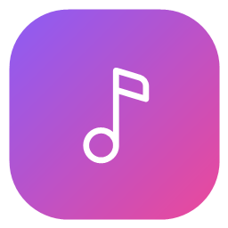
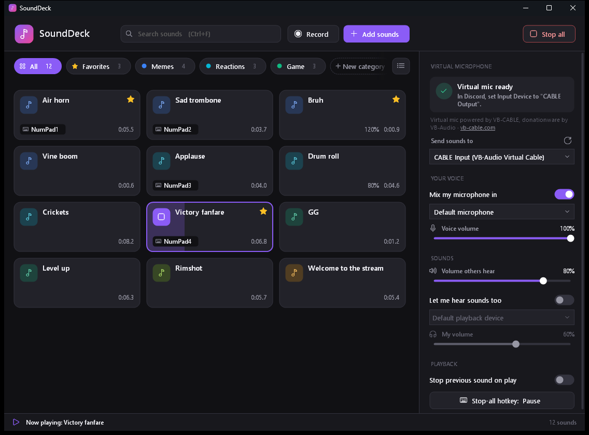
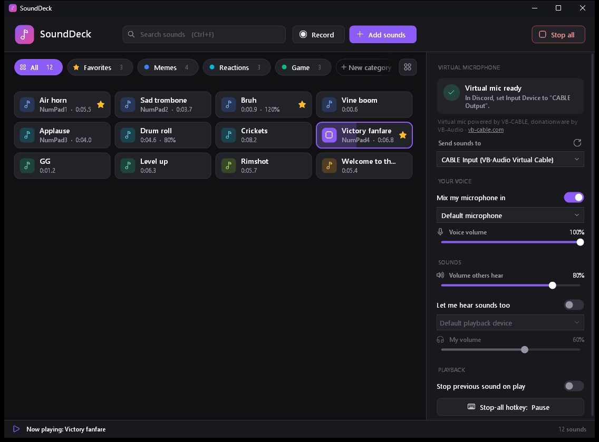
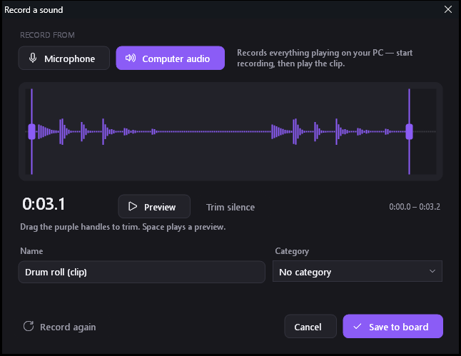

<p align="center">
  
</p>

<h1 align="center">SoundDeck</h1>

<p align="center">
  A free soundboard for Windows that plays sounds <b>through your microphone</b> into Discord, games, OBS and other voice apps.
  It has global hotkeys, categories and built-in recording.
</p>

<p align="center">
  <a href="../../releases/latest"><b>⬇ Download the latest version</b></a>
</p>



## Features

- **Plays into your mic.** People in voice chat hear your voice and your sounds together. SoundDeck mixes your real microphone in.
- **One-click virtual mic setup.** SoundDeck downloads and installs the free [VB-CABLE](https://vb-cable.com) driver for you, after checking that it's signed by VB-Audio.
- **Built-in noise removal for your mic.** It works as a replacement for Discord's Krisp, which also deletes your sound effects. It removes fan, hum and room noise from your voice before the sounds are mixed in, and fades out background noise between words.
- **Push-to-talk support.** SoundDeck holds your Discord push-to-talk key (or Mouse 4/5) down while a sound plays.
- **Global hotkeys.** Play any sound with a key, even while a game has focus. There's also a hotkey that stops everything.
- **Even loudness.** Every sound is measured in LUFS, the measure streaming services use, and matched to the same level, so no clip blows out people's ears. Per-sound volume (0–200%) works on top.
- **Instant replay.** SoundDeck can keep the last 30 seconds of your PC's audio in memory, so you can press a hotkey and save a funny moment *after* it happened.
- **Record sounds** from your microphone or from your PC's audio (for example a YouTube clip). Silence is trimmed automatically, and you can fine-tune the trim on the waveform.
- **Trim, loop and play modes** for any sound, without changing its file. When a playing sound is pressed again, it can stop, start over, or play another copy on top.
- **Categories and favorites.** Sort sounds into tabs, star your favorites, and switch tabs with Ctrl+1–9. Adding a folder turns it into a category.
- **Drag to reorder.** Move pads around, or drop one onto a tab to change its category.
- **Multi-select** (Ctrl/Shift+click) for bulk moving, favoriting and removing. **Ctrl+Z** undoes a removal.
- **Share boards.** Export your board with all its sounds as a single `.sdboard` file, and import your friends' boards.
- **Auto-updates.** An **Update** button appears when a new version is out. One click installs it and restarts.
- **Tray mode and start with Windows**, so your hotkeys are always ready. Headsets plugged in or out are picked up automatically.
- **Hear it yourself.** Optionally play sounds on your own headphones too, with a separate volume.
- **Search** across all sounds, and a **compact view** for big boards.
- **Supported formats:** MP3, WAV, M4A/AAC, WMA and FLAC.
- **Small and portable.** It's a single `.exe` of under 200 KB that needs no installation.

<p align="center">
  
  
</p>

## Getting started

1. [Download the latest release](../../releases/latest), unzip it somewhere permanent (for example Documents), and run `SoundDeck.exe`.
   > Windows may say *"Windows protected your PC"* because the app isn't code-signed. If it does, click **More info → Run anyway**.

   On first launch, a **setup guide** walks you through the steps below. It finishes with an automatic test: SoundDeck plays a chime into the virtual mic and listens on the other end, so you know Discord will hear your sounds. You can reopen the guide from **Settings (⚙) → App → Open the setup guide**.
2. In the sidebar, click **Install virtual mic**. You only need to do this once. Approve the Windows prompt, click **Install Driver**, and restart your PC if you're asked to.
3. In Discord, go to **Settings → Voice & Video** and set **Input Device** to **CABLE Output (VB-Audio Virtual Cable)**.
4. Keep **Mix my microphone in** turned on in SoundDeck, so people still hear you.
5. If you use push-to-talk in Discord, open **Settings (⚙) → Hotkeys → Push-to-talk key** and press the same key.

In Discord, also set **Noise Suppression** to *None*, and turn off **Echo Cancellation** and **Automatic Gain Control**. Discord's voice filters, Krisp especially, treat music and sound effects as noise and strip them out. You don't lose noise removal by doing this: SoundDeck's **Remove background noise** (on by default) cleans up your own microphone *before* the sounds are mixed in, so your voice gets filtered and your sounds don't.

## Using it

| | |
|---|---|
| **Add sounds** | Click **Add sounds**, or drag files or folders onto the window |
| **Play / stop** | Click a pad, then click it again to stop |
| **Hotkeys, volume, trim, loop, category, rename** | Right-click a pad |
| **Select several** | **Ctrl/Shift+click**, or **Ctrl+A**, then right-click or **Delete** |
| **Undo a removal** | **Ctrl+Z** |
| **Save the last 30 s** | **Settings → Instant replay**: turn it on and set its hotkey |
| **Share a board** | **Settings → App → Export board to share**. Friends use **Add sounds → Import a shared board** |
| **Volumes, voice, noise removal** | The sidebar on the right. Devices, hotkeys and app options are in **Settings (⚙)** |
| **Reorder** | Drag a pad. To change its category, drop it on a tab |
| **Favorites** | Click the ☆ on a pad |
| **Record** | **Record** button or **Ctrl+R** |
| **Search** | **Ctrl+F**, then **Enter** plays the first match |
| **Stop everything** | **Stop all**, **Esc**, or your stop-all hotkey |

Your board and settings are saved in `%APPDATA%\SoundDeck`. Recordings are saved as WAV files in `Documents\SoundDeck Recordings`.

**Privacy:** SoundDeck has no accounts and no telemetry. The only things it contacts on the internet are:
- GitHub's release API, once at startup, to check for updates.
- vb-audio.com, only if you click **Install virtual mic**.

Instant replay audio stays in memory and is never written to disk unless you save it.

> **Note:** SoundDeck has to be running for your voice to reach Discord while its input is set to *CABLE Output*. When you're done, switch Discord back to your normal microphone.

## How it works

```
 your mic ──┐
            ├─► SoundDeck mixer ──► CABLE Input ══ VB-CABLE ══► CABLE Output ──► Discord / game / OBS
 sounds ────┘          │
                       └──► your headphones (optional)
```

Windows can't create a microphone without a signed audio driver, so SoundDeck uses VB-CABLE as its virtual mic. Your microphone is cleaned up first, with an STFT Wiener noise suppressor plus a gate between words. Sounds are decoded with Windows Media Foundation and resampled to 48 kHz with a windowed-sinc filter. They're mixed with your microphone, run through a soft limiter so overlapping sounds don't distort, and sent to the cable. Recording your PC's audio uses WASAPI loopback.

## Building from source

There's no SDK or Visual Studio to install. SoundDeck builds with the C# compiler that ships with Windows (.NET Framework 4.x):

```powershell
powershell -ExecutionPolicy Bypass -File build.ps1      # builds SoundDeck.exe
powershell -ExecutionPolicy Bypass -File package.ps1    # builds dist\SoundDeck-<version>.zip
```

The code is in [`src/`](src). To test without touching your own board, set `SOUNDDECK_DATA` to another folder. That copy uses its own board and settings, and can run next to your normal one.

## Credits

The virtual microphone is **VB-CABLE** by VB-Audio Software ([vb-cable.com](https://vb-cable.com)). VB-CABLE is donationware: if you find it useful, please consider supporting its author. SoundDeck is not affiliated with VB-Audio.

## License

[MIT](LICENSE)
